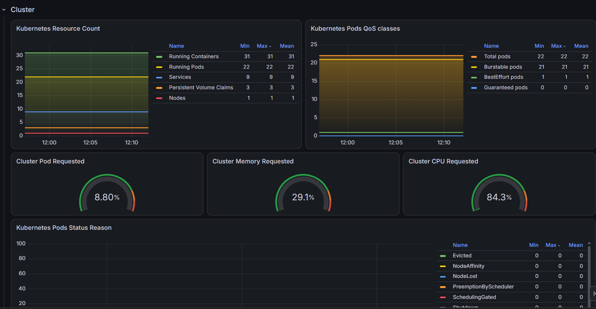
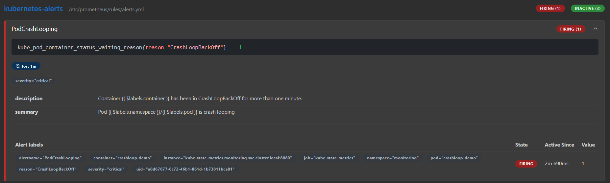
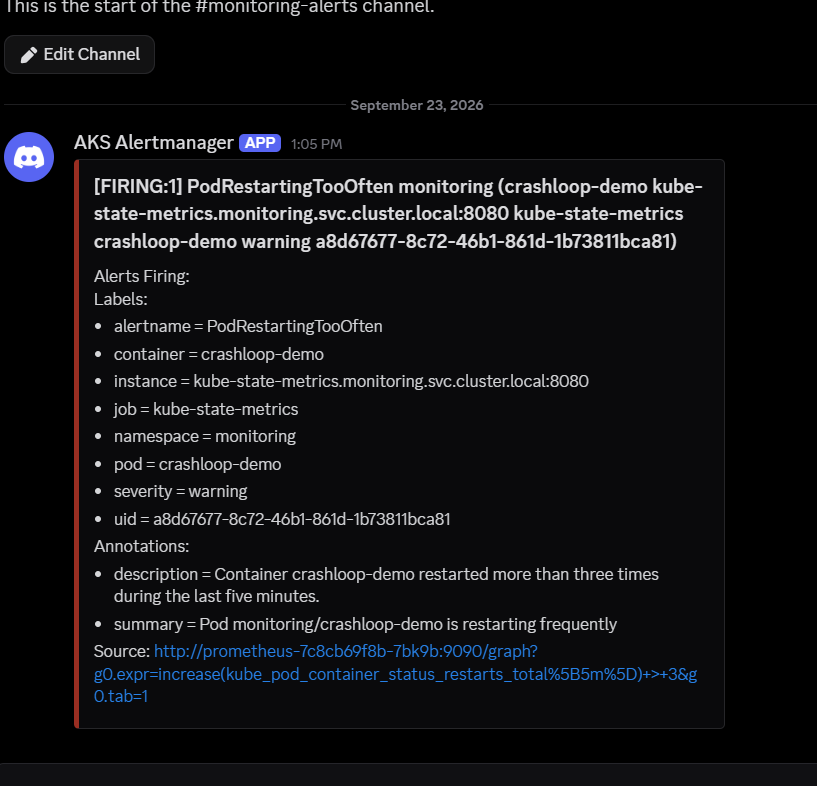
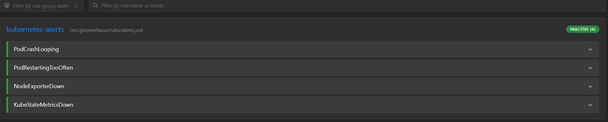
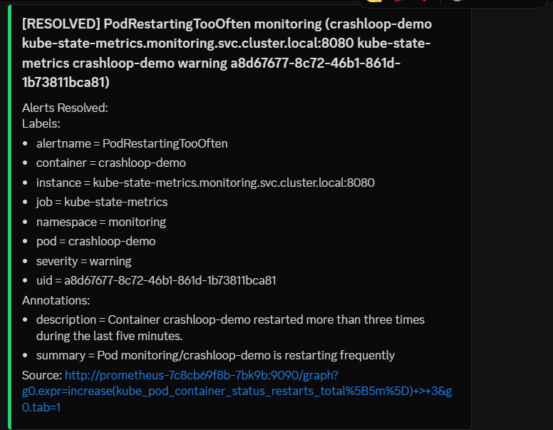
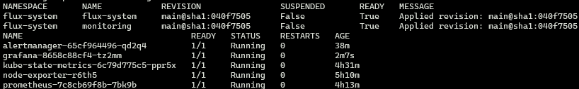

# AKS Prometheus Grafana Monitoring Stack

A Kubernetes monitoring stack running on Azure Kubernetes Service (AKS), defined manually with raw manifests and continuously reconciled from GitLab by Flux.

The project uses raw Kubernetes YAML manifests only:

- No Helm charts
- No Prometheus Operator
- No prebuilt `kube-prometheus-stack`

## Architecture

```text
GitLab main branch ──> Flux ──> AKS desired state

Node Exporter ──────────┐
                        ├──> Prometheus ──> Alertmanager ──> Discord
kube-state-metrics ─────┘         │
                                  └──> Grafana
                                       ├── Node dashboard
                                       └── Pod dashboard
```

## Components

| Component | Workload | Image |
|---|---|---|
| Prometheus | Deployment | `prom/prometheus:v3.13.3` |
| Alertmanager | Deployment | `prom/alertmanager:v0.34.1` |
| Grafana | Deployment | `grafana/grafana:13.1.6` |
| Node Exporter | DaemonSet | `prom/node-exporter:v1.12.1` |
| kube-state-metrics | Deployment | `registry.k8s.io/kube-state-metrics/kube-state-metrics:v2.19.1` |

## Features

- Node metrics collected with Node Exporter
- Kubernetes object metrics collected with kube-state-metrics
- Persistent storage for Prometheus, Alertmanager, and Grafana
- Automatic Grafana datasource provisioning
- Node and pod dashboards
- Prometheus alert rules
- Alertmanager Discord notifications
- Firing and resolved alert notifications
- GitOps continuous delivery with Flux
- Least-privilege Kubernetes RBAC
- Health and readiness probes
- CPU and memory requests and limits

## Repository structure

```text
.
├── clusters/
│   └── aks-hmezouar-tp/
│       ├── flux-system/
│       └── monitoring-kustomization.yaml
├── dashboards/
│   ├── nodes/
│   │   └── node-exporter-full.json
│   └── pods/
│       └── kube-state-metrics-v2.json
├── docs/
│   ├── images.md
│   └── screenshots/
├── k8s/
│   ├── 00-namespace/
│   ├── 01-prometheus/
│   ├── 02-alertmanager/
│   ├── 03-grafana/
│   ├── 04-node-exporter/
│   └── 05-kube-state-metrics/
└── tests/
    └── crashloop-pod.yaml
```

## Prerequisites

- An AKS cluster
- Azure CLI
- `kubectl`
- Flux CLI
- Access to the target cluster
- A Discord webhook for alert notifications

Verify the Kubernetes context:

```bash
kubectl config current-context
kubectl get nodes
```

## Secret configuration

Secrets are created directly in Kubernetes and are not committed to Git.

### Discord webhook

```bash
read -s -p "Discord webhook URL: " DISCORD_WEBHOOK_URL
echo

kubectl create secret generic alertmanager-discord \
  --namespace monitoring \
  --from-literal=webhook-url="$DISCORD_WEBHOOK_URL" \
  --dry-run=client \
  -o yaml | kubectl apply -f -

unset DISCORD_WEBHOOK_URL
```

### Grafana administrator

```bash
read -s -p "Grafana admin password: " GRAFANA_ADMIN_PASSWORD
echo

kubectl create secret generic grafana-admin \
  --namespace monitoring \
  --from-literal=admin-user=admin \
  --from-literal=admin-password="$GRAFANA_ADMIN_PASSWORD" \
  --dry-run=client \
  -o yaml | kubectl apply -f -

unset GRAFANA_ADMIN_PASSWORD
```

## Deployment

Deploy the namespace first:

```bash
kubectl apply -f k8s/00-namespace/
```

Create the two Secrets, then deploy the components:

```bash
kubectl apply -f k8s/04-node-exporter/
kubectl apply -f k8s/05-kube-state-metrics/
kubectl apply -f k8s/02-alertmanager/
kubectl apply -f k8s/01-prometheus/
kubectl apply -f k8s/03-grafana/
```

## GitOps continuous delivery with Flux

Flux is bootstrapped in the AKS cluster and watches the `main` branch of this repository. The `monitoring` Flux Kustomization reconciles the raw Kubernetes manifests under `k8s/`.

```text
Feature branch → Merge Request → main → Flux reconciliation → AKS
```

The GitOps configuration is stored under `clusters/aks-hmezouar-tp/`:

- `flux-system/` contains the bootstrapped Flux controllers and Git source.
- `monitoring-kustomization.yaml` maps the repository's `k8s/` directory to the AKS cluster.
- Pruning is enabled, so resources removed from Git are also removed from the cluster.

Verify the reconciliation state:

```bash
flux check
flux get sources git -A
flux get kustomizations -A
kubectl get pods -n flux-system
kubectl get pods -n monitoring
```

Both `flux-system` and `monitoring` should report `READY=True`, and all monitoring pods should be `Running`.

To request an immediate reconciliation after merging a change:

```bash
flux reconcile kustomization monitoring --with-source
```

## Verification

```bash
kubectl get pods -n monitoring
kubectl get services -n monitoring
kubectl get pvc -n monitoring
```

All application pods should be `Running`, and all PVCs should be `Bound`.

Verify the Node Exporter DaemonSet:

```bash
kubectl get daemonset node-exporter -n monitoring
```

Validate the configurations:

```bash
kubectl exec -n monitoring deployment/prometheus \
  -- promtool check config /etc/prometheus/config/prometheus.yml

kubectl exec -n monitoring deployment/prometheus \
  -- promtool check rules /etc/prometheus/rules/alerts.yml

kubectl exec -n monitoring deployment/alertmanager \
  -- amtool check-config /etc/alertmanager/alertmanager.yml
```

## Local access

### Prometheus

```bash
kubectl port-forward -n monitoring service/prometheus 19090:9090
```

Open <http://localhost:19090>.

### Alertmanager

```bash
kubectl port-forward -n monitoring service/alertmanager 19093:9093
```

Open <http://localhost:19093>.

### Grafana

```bash
kubectl port-forward -n monitoring service/grafana 13000:3000
```

Open <http://localhost:13000>.

## Prometheus targets

The following scrape jobs should be `UP`:

- `prometheus`
- `alertmanager`
- `node-exporter`
- `kube-state-metrics`

Check them at:

```text
http://localhost:19090/targets
```

## Dashboards

The project uses:

- Node Exporter Full — Grafana dashboard ID `1860`
- Kube State Metrics v2 — Grafana dashboard ID `21742`
- Kubernetes Pods Health Overview — dashboard ID `13826`

Exported dashboard JSON files are available under `dashboards/`.

## Alert rules

The project includes:

- `PodCrashLooping`
- `PodRestartingTooOften`
- `NodeExporterDown`
- `KubeStateMetricsDown`

## CrashLoopBackOff test

Deploy the intentionally failing pod:

```bash
kubectl apply -f tests/crashloop-pod.yaml
```

Observe its status:

```bash
kubectl get pod crashloop-demo -n monitoring --watch
```

The pod eventually enters `CrashLoopBackOff`. Prometheus changes the alert from `Pending` to `Firing`, and Alertmanager sends a Discord notification.

Clean up the test:

```bash
kubectl delete -f tests/crashloop-pod.yaml
```

Alertmanager then sends a `RESOLVED` notification.

## Evidence

Only screenshots that provide positive, reviewable evidence are included below.

### Kubernetes state dashboard



### Prometheus firing alert



### Discord firing notification



### Prometheus alerts resolved



### Discord resolved notification



### Flux GitOps reconciliation

The Flux controllers and monitoring Kustomization are ready, and every monitoring workload is running on AKS.



## Security

- Webhook URLs and passwords are stored in Kubernetes Secrets.
- Secret values are excluded from Git.
- Flux uses a read-only GitLab deploy token after bootstrap; the temporary personal access token should then be revoked.
- Containers run without privilege escalation.
- RBAC permissions are read-only and limited to required resources.
- Services use `ClusterIP` and are accessed locally with port forwarding.
